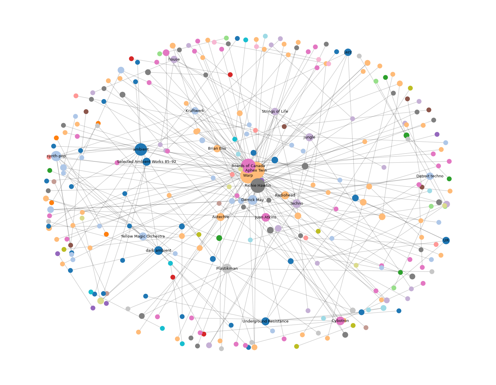

# Лабораторна робота №02. LLM-екстракція, векторний пошук та GraphRAG

**Студент:** Назар Багатченко
**Тема:** музика (електронна музика, виконавці, лейбли, жанри)

## 1. Предметна область, джерела і питання

**Предметна область:** електронна музика (техно, ambient, IDM), виконавці та лейбли.

**Корпус:** 9 статей англійської Wikipedia, разом ~32 000 слів (ліцензія CC BY-SA). Завантажуються скриптом `fetch_corpus.py` у папку `corpus/`.

| Стаття | Слів |
|---|---|
| [Aphex Twin](https://en.wikipedia.org/wiki/Aphex_Twin) | 5228 |
| [Boards of Canada](https://en.wikipedia.org/wiki/Boards_of_Canada) | 2785 |
| [Richie Hawtin](https://en.wikipedia.org/wiki/Richie_Hawtin) | 1660 |
| [Warp (record label)](https://en.wikipedia.org/wiki/Warp_(record_label)) | 2811 |
| [Techno](https://en.wikipedia.org/wiki/Techno) | 9907 |
| [Ambient music](https://en.wikipedia.org/wiki/Ambient_music) | 3785 |
| [Detroit techno](https://en.wikipedia.org/wiki/Detroit_techno) | 2258 |
| [Intelligent dance music](https://en.wikipedia.org/wiki/Intelligent_dance_music) | 1884 |
| [Selected Ambient Works 85–92](https://en.wikipedia.org/wiki/Selected_Ambient_Works_85%E2%80%9392) | 1680 |

**Питання до тексту:** 5 питань (3 прості, 2 на синтез з кількох документів), див. `questions.md`.

## 2. LLM-екстракція

### Схема сутностей і зв'язків

Схема описана в `schema.py` через `pydantic`. Один факт це трійка «суб'єкт, зв'язок, об'єкт» плюс типи сутностей і цитата з тексту.

**5 типів сутностей:** `Artist`, `Album`, `Label`, `Genre`, `Person`.

**6 типів зв'язків:** `released`, `signed_to`, `has_genre`, `influenced_by`, `founded`, `member_of`.

Крім цього, кожен факт має поле `evidence`: коротка цитата з тексту, з якої факт узято. Вона потрібна, щоб легко перевіряти факти вручну.

### Як працює екстракція

Код у `extract.py`. Кожну статтю з `corpus/` ділимо на шматки по 3000 символів і відправляємо в **Gemini API** (пакет `google-genai`). Модель одразу повертає JSON за нашою схемою (structured output: `response_mime_type="application/json"` і `response_schema`). У промпті сказано брати тільки те, що прямо написано в тексті, і не вгадувати. Результат зберігається у `facts.json`, до кожного факту додається назва статті-джерела.

### Результат

Видобуто **302 факти** з 9 статей (мінімум за завданням 30). Розподіл за зв'язками: `released` 132, `influenced_by` 50, `has_genre` 44, `member_of` 39, `founded` 25, `signed_to` 12.

Приклади видобутих фактів:

| Факт | Цитата з тексту |
|---|---|
| Skam Records → `released` → Hi Scores | «…contacting Skam Records, leading to the release of Hi Scores in 1996 on the label.» |
| Boards of Canada → `signed_to` → Warp | «In 1998, Warp signed the electronic duo Boards of Canada» |
| Jeff Mills → `member_of` → Underground Resistance | «Underground Resistance (featuring Mike Banks, Jeff Mills, and Robert Hood)» |
| Juan Atkins → `member_of` → Cybotron | «Atkins began recording with musical partner Richard Davis (and later with a third member, Jon-5) as Cybotron.» |

### Ручна перевірка

Для перевірки взято **20 випадкових фактів** (`sample_check.py`, `random.seed(42)`). Кожен факт порівнювався з оригінальною статтею: чи є таке речення, чи правильні типи сутностей і напрямок зв'язку. Повна таблиця з цитатами та вердиктами в `verification.md`.

**Результат: 18 з 20 правильні (90%).** Вигаданих фактів у вибірці не було.

Типові помилки моделі:

- **Неправильний тип сутності** (2 з 20). «The San Francisco Tape Music Center» модель назвала лейблом, хоча це студія. У схемі немає підходящого типу, тому вона взяла найближчий.
- **Одна сутність під різними іменами.** «James» і «Aphex Twin» це одна людина, а «Sandison brothers» це гурт Boards of Canada, але модель їх не об'єднала. У графі вони стануть різними вузлами.
- **Неточний тип.** EP записано як `Album`.
- **Цитата не дослівна** (1 з 20): модель змінила регістр літери, сам факт правильний.

Чого ця перевірка не показує: чи не пропустила модель важливі факти. Для цього треба було б самому читати статті і шукати факти.

## 3. Векторний пошук

### Чанки

Статті поділено на **чанки по 1000 символів з перекриттям 200** (`build_index.py`). Разом вийшло 252 чанки, у середньому ~990 символів (приблизно 150 слів).

Чому так:

- 1000 символів це 2–4 речення. Цього досить, щоб факт був з контекстом, але в чанку лишається одна думка, і збіг з запитом не розмивається.
- Перекриття 200 символів потрібне, щоб факт, який випав на межу двох чанків, не розрізався навпіл.

### Ембединги і пошук

- Ембединги рахує **Gemini Embedding API** (`gemini-embedding-001`), 3072 числа на чанк.
- Вони зберігаються в звичайному numpy-масиві `embeddings.npy`, тексти чанків у `chunks.json`. Окрема база не потрібна, бо чанків небагато.
- Вектори нормалізовані, тому cosine similarity це просто скалярний добуток.
- Функція `vector_search(query, n)` в `search.py` перетворює запит на вектор і повертає топ-N найближчих чанків.

### Порівняння з keyword-пошуком

Для порівняння взято звичайний пошук за словами, **TF-IDF** (`keyword_search` в `search.py`). Запустив обидва на трьох запитах (`python search.py`). У таблиці показано, чи є потрібний чанк у топ-3.

| Запит | Keyword (TF-IDF) | Векторний |
|---|---|---|
| Which sibling pair makes retro-sounding tracks inspired by old television programmes from the seventies? | ні | **так, на 1 місці** |
| 76:14 | **так, на 1 місці** | ні |
| Which label released Selected Ambient Works 85-92? | так, на 1 місці | так, на 1 місці |

**Де виграє семантичний пошук.** Перший запит перефразований: у статті про Boards of Canada написано «duo consisting of brothers» і «public broadcasting media», а в запиті «sibling pair» і «television programmes». Спільних слів майже немає, тому TF-IDF нічого не знаходить. Ембединг порівнює зміст, тому правильний чанк стоїть першим.

**Де програє.** `76:14` це назва альбому Global Communication, тобто просто код без змісту. Ембединг не має за що вхопитись і повертає випадкові чанки про Aphex Twin. TF-IDF знаходить цей рядок дослівно. Так само вектор не знайшов слово `ISDN`.

**Звичайне питання** з нашого списку обидва методи розв'язують однаково, бо в запиті є і ті самі слова, і той самий зміст.

Окремо: усі точні імена, які я пробував (наприклад Mighty Force, Casio FZ-10M), векторний пошук теж знайшов. Тобто Gemini добре працює з рідкісними іменами, а не справляється саме з кодами і числами.

## 4. Граф знань і GraphRAG

### Граф

Граф будує `build_graph.py` бібліотекою `networkx` з 302 фактів у `facts.json`. Вузли це сутності, ребра це зв'язки між ними (`released`, `founded` тощо).

- Вийшло **288 вузлів і 268 ребер**.
- Модель інколи називає одну сутність по-різному (див. розділ про ручну перевірку). Тому додано невеликий словник замін: «James» → Aphex Twin, «Warp Records» → Warp, «Apollo» → Apollo Records, «Rephlex» → Rephlex Records, «Hawtin» → Richie Hawtin, «Sandison brothers» → Boards of Canada, «ambient» → Ambient music. Також прибираються невидимі символи з назв.
- Візуалізація: `graph.png` (колір вузла це спільнота, розмір це кількість зв'язків, підписані тільки найбільші вузли).



### GraphRAG-пайплайн

1. **Спільноти.** `python-louvain` (`best_partition`) знайшов 52 спільноти. З них 11 великі (від 5 до 35 вузлів), решта це пари й трійки вузлів.
2. **Резюме спільнот** (`graphrag.py`). Для кожної з 11 великих спільнот у промпт для Gemini виписуємо всі зв'язки всередині неї, наприклад `Warp --founded--> Gift Records`, і просимо коротке резюме з 3–4 речень. Результат у `community_summaries.json`. Наприклад, одна спільнота це Warp і його засновники, інша Underground Resistance, ще одна Boards of Canada.
3. **Фінальна відповідь** (`answer.py`). Усі 11 резюме йдуть в один запит до LLM, і вона відповідає на питання тільки за ними (map-reduce: по одному резюме на спільноту, потім один запит з усіма).

### Відповіді на «глобальне» питання

Питання №5 з `questions.md`: *як електронна музика розвинулась від Detroit techno та Brian Eno до IDM, і які виконавці та лейбли пов'язують ці жанри?* Це питання потребує інформації з кількох статей. Повні відповіді в `answers.md`.

**GraphRAG** (резюме всіх спільнот) відповів так:

- Detroit techno: Cybotron (Juan Atkins), Belleville Three (Derrick May, Kevin Saunderson), Underground Resistance, Richie Hawtin.
- Ambient: Brian Eno і John Cage як основа, з якої виросли ambient і IDM.
- IDM: Aphex Twin, Autechre, Boards of Canada.
- Лейбли разом з виконавцями: Warp, Apollo, Rephlex, Plus 8, M-nus, Metroplex.

**Vector-RAG** (топ-5 чанків напряму в LLM, без графа) відповів так:

- Прямо написав, що Brian Eno у знайдених текстах не згадується.
- Розповів тільки про IDM: звідки взявся, що назва пішла від збірки *Artificial Intelligence* (Warp, 1992).
- Назвав виконавців і лейбли IDM списком, без зв'язків між ними.

### Порівняння

| | GraphRAG | Vector-RAG |
|---|---|---|
| Повнота | охопив Detroit techno, ambient і IDM | тільки IDM |
| Brian Eno | є | немає |
| Лейбли | кожен пов'язаний з виконавцями | довший список, але без зв'язків |
| Деталі | без дат і подробиць | є дати й подробиці (збірка 1992 року) |
| Точність | подекуди робить висновки сильніше, ніж у статтях | тримається тексту і чесно каже, чого немає |

**Чому така різниця.** Vector-RAG шукає чанки, найближчі до запиту. У запиті є слово IDM, тому 4 з 5 знайдених чанків із статті про IDM, а інформація про Eno і Detroit лежить в інших статтях і до LLM не потрапила. GraphRAG працює з резюме всього графа, тому бачить увесь корпус і може скласти узагальнення, якого немає в жодному окремому чанку: лінію Detroit techno → ambient → IDM і зв'язки лейблів з виконавцями.

Недолік GraphRAG: резюме губить подробиці (дати, причини), а модель частково додумує зв'язки, наприклад, що Aphex Twin «поєднав» Eno з IDM. Vector-RAG точніший у тому, що бачить, але бачить тільки знайдені чанки.

## 5. Помилки та їх виправлення

TODO

## 6. Висновки

TODO

## Запуск

```
python -m venv .venv && source .venv/bin/activate
pip install -r requirements.txt
cp .env.example .env   # вписати свій GEMINI_API_KEY з aistudio.google.com
```
